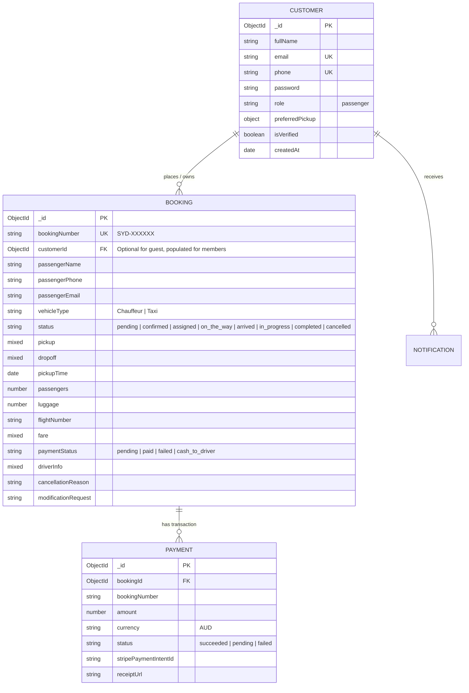

# Customer / Passenger Panel — Backend Data Structure & API Specification

> **Target Audience:** Backend Development Team (`syd-bookings-server`)  
> **Purpose:** Detailed REST API contracts, MongoDB Schemas, authentication flow, and data payloads required by the Frontend Customer Portal.

---

## 1. Architecture & Entity-Relationship Overview



---

## 2. Customer Database Model (`models/customer.model.js`)

```javascript
import mongoose from 'mongoose';

const customerSchema = new mongoose.Schema(
  {
    fullName: {
      type: String,
      required: [true, 'Full name is required'],
      trim: true,
    },
    email: {
      type: String,
      required: [true, 'Email is required'],
      unique: true,
      lowercase: true,
      trim: true,
      index: true,
    },
    phone: {
      type: String,
      required: [true, 'Phone number is required'],
      unique: true,
      trim: true,
      index: true,
    },
    password: {
      type: String,
      required: [true, 'Password is required'],
      select: false,
      minlength: 6,
    },
    role: {
      type: String,
      default: 'passenger',
      enum: ['passenger'],
    },
    avatar: {
      type: String,
      default: '',
    },
    preferences: {
      defaultLuggage: { type: Number, default: 2 },
      defaultPassengers: { type: Number, default: 1 },
      preferredVehicleType: { type: String, enum: ['Chauffeur', 'Taxi', 'All'], default: 'Chauffeur' },
      favoritePlaces: [
        {
          label: { type: String, default: 'Home' }, // e.g. "Home", "Office", "Sydney Airport (SYD)"
          address: { type: String, required: true },
        },
      ],
    },
    isVerified: {
      type: Boolean,
      default: true, // or false if OTP verification is implemented
    },
    lastLoginAt: {
      type: Date,
      default: null,
    },
  },
  {
    timestamps: true,
    toJSON: { virtuals: true },
    toObject: { virtuals: true },
  }
);

export const Customer = mongoose.models.Customer || mongoose.model('Customer', customerSchema);
```

---

## 3. Booking Model Extensions (`models/booking.model.js`)

In the existing `bookingSchema`, please ensure the following fields are supported:

```javascript
// Link to customer if authenticated
customerId: {
  type: mongoose.Schema.Types.ObjectId,
  ref: 'Customer',
  default: null,
  index: true,
},

// Assigned Driver details (visible in Live Tracking)
driverInfo: {
  driverName: { type: String, default: '' },
  driverPhone: { type: String, default: '' },
  vehicleMakeModel: { type: String, default: '' }, // e.g. "Mercedes-Benz E-Class Black"
  licensePlate: { type: String, default: '' },     // e.g. "SYD-888"
  currentLocation: {
    lat: { type: Number, default: null },
    lng: { type: Number, default: null },
  },
  etaMinutes: { type: Number, default: null },
},

// Flight tracking number for airport pickups
flightNumber: {
  type: String,
  trim: true,
  default: '',
},

// Passenger modification request
modificationRequest: {
  requestedAt: { type: Date, default: null },
  newPickupTime: { type: Date, default: null },
  note: { type: String, default: '' },
  status: { type: String, enum: ['none', 'pending_approval', 'approved', 'rejected'], default: 'none' },
},
```

---

## 4. REST API Endpoint Specifications

Base Prefix: `/api/customer`

### 4.1 Authentication Endpoints

#### `POST /api/customer/register`
Creates a new customer account.
- **Request Body:**
  ```json
  {
    "fullName": "Rahim Ahmed",
    "email": "rahim@example.com",
    "phone": "+61 412 345 678",
    "password": "SecurePassword123"
  }
  ```
- **Response (201 Created):**
  ```json
  {
    "success": true,
    "message": "Registration successful",
    "token": "JWT_AUTH_TOKEN_HERE",
    "customer": {
      "id": "672d8a9e0f34...",
      "fullName": "Rahim Ahmed",
      "email": "rahim@example.com",
      "phone": "+61 412 345 678",
      "preferences": {
        "defaultPassengers": 1,
        "defaultLuggage": 2,
        "preferredVehicleType": "Chauffeur",
        "favoritePlaces": []
      }
    }
  }
  ```

---

#### `POST /api/customer/login`
Authenticates an existing customer via Email/Phone and Password.
- **Request Body:**
  ```json
  {
    "identifier": "rahim@example.com", // Can be email or phone
    "password": "SecurePassword123"
  }
  ```
- **Response (200 OK):**
  ```json
  {
    "success": true,
    "message": "Login successful",
    "token": "JWT_AUTH_TOKEN_HERE",
    "customer": {
      "id": "672d8a9e0f34...",
      "fullName": "Rahim Ahmed",
      "email": "rahim@example.com",
      "phone": "+61 412 345 678",
      "preferences": { ... }
    }
  }
  ```

---

#### `GET /api/customer/me`
Retrieves current profile details (Requires `Authorization: Bearer <token>`).
- **Response (200 OK):**
  ```json
  {
    "success": true,
    "customer": {
      "id": "672d8a9e0f34...",
      "fullName": "Rahim Ahmed",
      "email": "rahim@example.com",
      "phone": "+61 412 345 678",
      "preferences": {
        "defaultPassengers": 2,
        "defaultLuggage": 2,
        "preferredVehicleType": "Chauffeur",
        "favoritePlaces": [
          { "label": "Home", "address": "Manly, NSW" }
        ]
      }
    }
  }
  ```

---

#### `PUT /api/customer/profile`
Updates customer profile and default booking preferences.
- **Request Body:**
  ```json
  {
    "fullName": "Rahim Ahmed",
    "phone": "+61 412 345 678",
    "preferences": {
      "defaultPassengers": 2,
      "defaultLuggage": 3,
      "preferredVehicleType": "Chauffeur",
      "favoritePlaces": [
        { "label": "Home", "address": "Bondi Beach, NSW" }
      ]
    }
  }
  ```
- **Response (200 OK):**
  ```json
  {
    "success": true,
    "message": "Profile updated successfully",
    "customer": { ... }
  }
  ```

---

### 4.2 Customer Bookings & History Endpoints

#### `GET /api/customer/bookings`
Returns paginated list of bookings owned by the authenticated customer (matched by `customerId` or `passengerEmail`/`passengerPhone`).
- **Query Parameters:**
  - `status`: Filter by `upcoming` | `past` | `cancelled` | `all`
  - `page`: default `1`
  - `limit`: default `10`
- **Response (200 OK):**
  ```json
  {
    "success": true,
    "total": 12,
    "page": 1,
    "limit": 10,
    "bookings": [
      {
        "id": "672d90fa9e...",
        "bookingNumber": "SYD-9V2K41",
        "vehicleType": "Chauffeur",
        "pickup": "Sydney Airport (SYD)",
        "dropoff": "Sydney CBD",
        "pickupTime": "2026-11-15T09:30:00.000Z",
        "passengers": 2,
        "luggage": 2,
        "flightNumber": "QF12",
        "fare": { "total": 125, "currency": "AUD" },
        "status": "confirmed",
        "paymentStatus": "paid",
        "driverInfo": {
          "driverName": "David Miller",
          "driverPhone": "+61 400 111 222",
          "vehicleMakeModel": "Mercedes-Benz S-Class",
          "licensePlate": "CH-9021"
        },
        "createdAt": "2026-11-07T12:00:00.000Z"
      }
    ]
  }
  ```

---

### 4.3 Live Tracking & Status Details

#### `GET /api/customer/bookings/:bookingNumber/track`
Returns real-time lifecycle tracking details for a specific booking.
- **Response (200 OK):**
  ```json
  {
    "success": true,
    "tracking": {
      "bookingNumber": "SYD-9V2K41",
      "status": "on_the_way", 
      "statusHistory": [
        { "status": "pending", "timestamp": "2026-11-15T08:00:00Z" },
        { "status": "confirmed", "timestamp": "2026-11-15T08:05:00Z" },
        { "status": "assigned", "timestamp": "2026-11-15T08:30:00Z" },
        { "status": "on_the_way", "timestamp": "2026-11-15T09:05:00Z" }
      ],
      "driver": {
        "driverName": "David Miller",
        "driverPhone": "+61 400 111 222",
        "vehicleMakeModel": "Mercedes-Benz S-Class (Black)",
        "licensePlate": "CH-9021",
        "etaMinutes": 12
      },
      "trip": {
        "pickup": "Sydney Airport (SYD)",
        "dropoff": "Sydney CBD",
        "pickupTime": "2026-11-15T09:30:00.000Z",
        "flightNumber": "QF12"
      }
    }
  }
  ```

---

### 4.4 Booking Cancellation & Modification Request

#### `POST /api/customer/bookings/:bookingNumber/cancel`
Cancels the booking.
- **Request Body:**
  ```json
  {
    "reason": "Flight rescheduled to tomorrow morning"
  }
  ```
- **Response (200 OK):**
  ```json
  {
    "success": true,
    "message": "Booking cancelled successfully",
    "bookingNumber": "SYD-9V2K41",
    "status": "cancelled",
    "refundStatus": "eligible_for_refund"
  }
  ```

#### `POST /api/customer/bookings/:bookingNumber/modify`
Requests a time change or pickup note update.
- **Request Body:**
  ```json
  {
    "newPickupTime": "2026-11-15T11:00:00.000Z",
    "note": "Flight delayed by 1.5 hours"
  }
  ```
- **Response (200 OK):**
  ```json
  {
    "success": true,
    "message": "Modification request submitted to dispatch team",
    "bookingNumber": "SYD-9V2K41",
    "modificationStatus": "pending_approval"
  }
  ```

---

### 4.5 Invoice & Receipt Endpoint

#### `GET /api/customer/bookings/:bookingNumber/invoice`
Returns structured invoice data for the frontend to render and print/download.
- **Response (200 OK):**
  ```json
  {
    "success": true,
    "invoice": {
      "invoiceNumber": "INV-2026-9V2K41",
      "date": "2026-11-15",
      "bookingNumber": "SYD-9V2K41",
      "passenger": {
        "fullName": "Rahim Ahmed",
        "email": "rahim@example.com",
        "phone": "+61 412 345 678"
      },
      "service": {
        "category": "Executive Chauffeur Service",
        "pickup": "Sydney Airport (SYD)",
        "dropoff": "Sydney CBD",
        "date": "15 Nov 2026",
        "time": "09:30 AM"
      },
      "breakdown": {
        "baseFare": 105.00,
        "airportToll": 15.00,
        "gst": 12.00,
        "surcharge": {
          "cardType": "domestic",
          "rate": "1.65% + $0.30",
          "amount": 2.27
        },
        "total": 127.27,
        "currency": "AUD"
      },
      "payment": {
        "method": "Card (Stripe)",
        "status": "PAID",
        "transactionId": "pi_3MtwxQLkdIwHu7ix28a3tqPa",
        "paidAt": "2026-11-07T12:05:22.000Z"
      }
    }
  }
  ```

---

### 4.6 Payment Intent & Surcharge Endpoint (`POST /api/payments/create-intent`)
When initializing card payment with Stripe, the frontend sends the calculated surcharge and base fare:
- **Request Body:**
  ```json
  {
    "bookingId": "672d90fa9e...",
    "bookingNumber": "SYD-9V2K41",
    "amount": 127.27,
    "baseFare": 125.00,
    "surcharge": 2.27,
    "cardType": "domestic",
    "currency": "AUD"
  }
  ```
- **Stripe Official Processing Rates in Australia:**
  - **Australian Domestic Cards:** `1.65% + A$0.30`
  - **International Cards:** `3.50% + A$0.30`
  - Pass-through surcharge formula: `(baseFare * rate.percentage) + rate.fixed`
- **Response (200 OK):**
  ```json
  {
    "success": true,
    "clientSecret": "pi_3Mtwx..._secret_...",
    "publishableKey": "pk_test_...",
    "amount": 127.27,
    "currency": "AUD"
  }
  ```

---

## 5. Security & Authentication Header

All authenticated endpoints must expect:
```http
Authorization: Bearer <JSON_WEB_TOKEN>
```
The token payload should contain `{ id: customer._id, email: customer.email, role: 'passenger' }` and be signed with standard `JWT_SECRET`.
